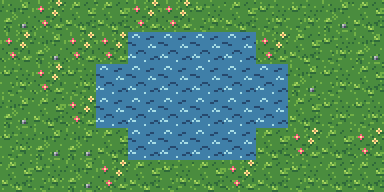
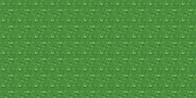
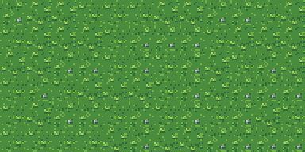
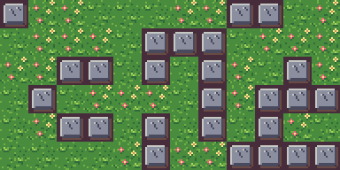
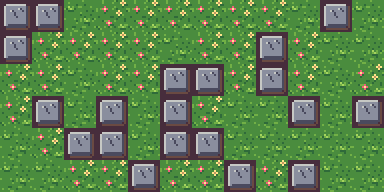

# 10 · Map variants

You'll fill a meadow without placing a single grass tile by hand: one legend line lists a few
tiles, and each cell of the map picks one. Then you'll make some tiles rarer than others, see
why two rooms with the same rows come out different, and add a pond whose water moves once the
room is in Tiled.




## The idea

In [06 · Scenes and maps](../06-scene) every legend line named one tile, so every `g` in the
rows drew the same grass. A field of identical tiles shows its repeat. A legend line can name
several tiles instead:

```map
g ../tiles/field.px:grass_a ../tiles/field.px:grass_b ../tiles/field.px:grass_c
```

That's a **variant list**. Each cell that has a `g` draws one of the three. The pick isn't
random: it comes from a hash of the room's name (the map's file name without `.map`) and the
cell's column and row. So a map looks the same every time it's drawn, by `scene`, by
`compose --map` and in Tiled, and a game that reads the compiled room shows what you saw.


## Before you start

From this folder, copy just the source files into a new folder of your own and go
there. The commands below then make every output fresh, and print exactly what's shown
here:

```sh
mkdir -p ~/pxart-10
cp -R pal tiles rooms picks ~/pxart-10/
cd ~/pxart-10
```

`~` is your home folder, and `-p` keeps `mkdir` quiet if the folder is already there.
The [examples README](../README.md) says how to make `pxart` a command you can type.

The tiles come from two packs: the glade's field tiles from tutorial 06 (in `tiles/field.px`,
with their colors in `pal/field.px`) and the harbor's water from tutorial 08 (`tiles/harbor.px`).


## Step 1: One tile everywhere

[`rooms/plain.map`](rooms/plain.map) fills a 12x6 meadow with one tile:

```map
# A meadow of one grass tile: every cell the same, and the repeat shows.
g ../tiles/field.px:grass_a

gggggggggggg
gggggggggggg
...
```

```sh
pxart scene --map rooms/plain.map --scale 2 -o plain.x2.png
```



It's grass, but the same 16x16 square over and over reads as wallpaper.


## Step 2: A variant list

[`rooms/meadow.map`](rooms/meadow.map) has the same rows, and its legend line lists three
grass tiles:

```map
g ../tiles/field.px:grass_a ../tiles/field.px:grass_b ../tiles/field.px:grass_c
```

```sh
pxart scene --map rooms/meadow.map --scale 2 -o meadow.x2.png
```



The three tiles are close on purpose (`grass_b` and `grass_c` add a few pebbles), so the
meadow looks like one field rather than a checkerboard, and the repeat is gone.

A legend line is a variant list when it has two or more items and every one names a tile:
a `.px` file (with a `:frame` if it has several) or a `.png`. Each item can have its own
`%variant` and flips, such as `+h`. A single path with spaces in it, like
`b ../png/trees and bushes/bush.png`, stays one path.


## Step 3: See the picks

Close tiles make the picks hard to see. [`picks/meadow.map`](picks/meadow.map) has the same
room name and rows as `rooms/meadow.map`, so every cell picks the same way, but its three
tiles are grass, flowers and a stone:

```sh
pxart scene --map picks/meadow.map --scale 2 -o picks-meadow.x2.png
```



Every stone here is a cell that drew `grass_c` in step 2, and every patch of flowers drew
`grass_b`. Each tile gets about a third of the cells.


## Step 4: Another room, other picks

[`rooms/meadow-east.map`](rooms/meadow-east.map) is a copy of `meadow.map`: the same legend,
the same rows. Only its name differs, and the name is part of the hash. Its picks, made
visible the same way:

```sh
pxart scene --map picks/meadow-east.map --scale 2 -o picks-meadow-east.x2.png
```



So rooms that share their rows still look different from each other, and none of them
changes from one render to the next. Renaming a map changes its picks, so name a room
before you fine-tune how it looks.


## Step 5: Some tiles rarer than others

Each item in a list is equally likely. To make a tile commoner, list it more than once;
to make one rare, list the others more often. [`rooms/pond.map`](rooms/pond.map) lists the
three grass tiles twice and `flowers` twice, so flowers grow in about one cell of four:

```map
g ../tiles/field.px:grass_a ../tiles/field.px:grass_b ../tiles/field.px:grass_c ../tiles/field.px:grass_a ../tiles/field.px:grass_b ../tiles/field.px:grass_c ../tiles/field.px:flowers ../tiles/field.px:flowers
w ../tiles/harbor.px:water/0

gggggggggggg
ggggwwwwgggg
gggwwwwwwggg
gggwwwwwwggg
ggggwwwwgggg
gggggggggggg
```

`w` is the harbor's water. Its frames are an animation, `water/0` and `water/1`, but a map
cell draws one frame, so the legend names the first.

```sh
pxart check rooms/
```

```text
ok   rooms/meadow-east.map: map 12x6 tiles, 1 legend char(s)
ok   rooms/meadow.map: map 12x6 tiles, 1 legend char(s)
ok   rooms/plain.map: map 12x6 tiles, 1 legend char(s)
ok   rooms/pond.map: map 12x6 tiles, 2 legend char(s)
4 files, 0 frames, 0 warnings
```

```sh
pxart scene --map rooms/pond.map --scale 2 -o pond.x2.png
```


`scene` draws a still picture, so the pond is still too.


## Step 6: Water that moves, in Tiled

[Tiled](https://www.mapeditor.org/), and the game engines that read its files, animate a tile
when its tileset says how. Export the tiles as two tilesets into `tiled/`:

```sh
pxart export tiles/field.px:grass_a tiles/field.px:grass_b tiles/field.px:grass_c tiles/field.px:flowers --tiled tiled/field.tsj
pxart export tiles/harbor.px:water --tiled tiled/water.tsj
```

```text
created tiled/
wrote tiled/field.png tiled/field.tsj
wrote tiled/water.png tiled/water.tsj
```

[`tiled/water.tsj`](tiled/water.tsj) gives the water's first tile the animation, its frames
with their `ms` from the `@anim` line in `harbor.px`. Its entry, without the property naming
the group:

```json
{"id": 0, "animation": [{"tileid": 0, "duration": 450}, {"tileid": 1, "duration": 450}]}
```

Then compile the room. pxart finds the tilesets in a `tiled/` folder in the map's folder or
one above it, here the example's own:

```sh
pxart export rooms/pond.map --tiled
```

```text
wrote rooms/pond.tmj: 12x6, 0 objects (0 kept ids, 0 new)
```

Open [`rooms/pond.tmj`](rooms/pond.tmj) in Tiled. Every water cell is the animated tile, so
the pond moves, and every grass cell is the tile `scene` picked for it, so the meadow is the
one in the picture above.

Every water tile animates in step, because the animation belongs to the tile, not the cell.


## Try it yourself

- **Rename a room.** Copy `rooms/pond.map` to `rooms/lake.map` and render it: the same pond,
  and different grass.
- **Grow more flowers.** Add a third `../tiles/field.px:flowers` to the `g` line of
  `rooms/pond.map`, and render again.
- **Mirror some flowers.** Change one `../tiles/field.px:flowers` to
  `../tiles/field.px:flowers+h`, so half the flower cells face the other way.


## Commands used

- `pxart scene --map FILE.map -o OUT.png`: render a map, picking each variant cell's tile.
  `pxart help scene`
- `pxart check DIR`: check every `.map` (and `.px`) under a folder. `pxart help check`
- `pxart export FILE.px[:FRAME...] --tiled OUT.tsj`: a Tiled tileset, with animations.
  `pxart help export`
- `pxart export ROOM.map --tiled`: compile a map for Tiled, with the same picks.
  `pxart help worlds`

The [Commands section](../../README.md#commands) of the main README covers all of them.
